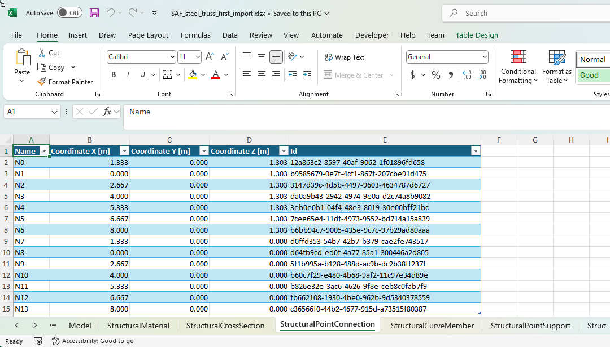

# Why use SAF for a Checkbot link?

## What SAF is

The [Structural Analysis Format](https://www.saf.guide) (SAF) is an open format for exchanging structural analysis
models between programs. The Nemetschek Group started it, and SCIA coordinates it. A SAF file is an Excel workbook
with one sheet for each kind of object: nodes, members, cross-sections, materials, load cases, and also the internal
forces of members.

## Two ways to link an FEA application

Checkbot imports an IDEA Open Model (IOM). A link has to make one from the model of the FEA application, in one of
two ways:

| Link | How the model reaches Checkbot |
|---|---|
| A SAF link, like the [SAF FEA link example](README.md) | The FEA application saves a SAF file. The [IdeaStatiCa.SAF2IOM](https://www.nuget.org/packages/IdeaStatiCa.SAF2IOM) package converts it to IOM. |
| A BimApiLink link, like the [FEA link example](../FeaExample/README.md) | The link reads the model through the API of the FEA application, object by object, and converts each object itself. |

Our link for SCIA Engineer is a SAF link.

## Advantages of a SAF link

- Much less code. If your application can already save SAF files, your link is not much more than the example.
- Your SAF export is useful on its own: every program that reads SAF can use it, not only IDEA StatiCa.
- When SAF2IOM improves, your link improves with a package update.

## Disadvantages of a SAF link

- SAF and IOM do not describe the same things, so some objects cannot pass from one to the other.
- Writing and reading a file is slower than reading the model through an API.
- Your application must give every object the same SAF id in every export. The link finds the objects it imported
  before by these ids.
- SAF2IOM does not convert every part of SAF yet.
