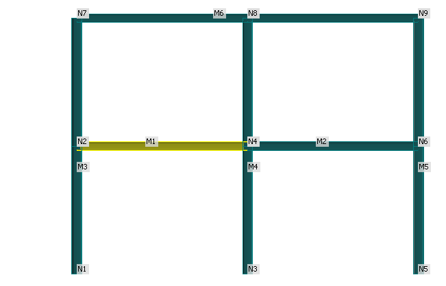
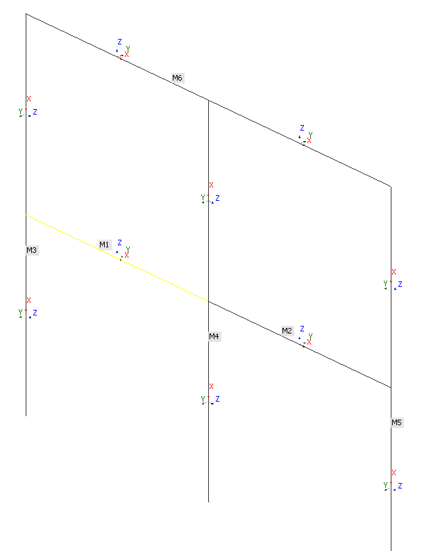
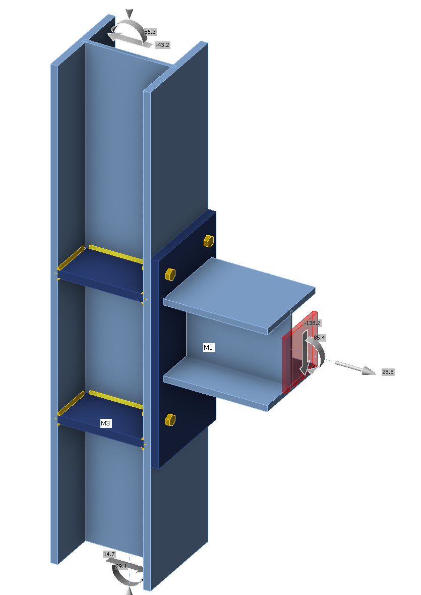

# IOM steel frame example

This example builds a steel frame in IOM, the IDEA Open Model, with the
[IdeaStatiCa.OpenModel](https://www.nuget.org/packages/IdeaStatiCa.OpenModel) package. Then it creates an IDEA StatiCa
Connection project from it, in one of two ways: with the Connection API of the IDEA StatiCa installed on your computer,
or with the IDEA StatiCa Viewer web service, which needs no IDEA StatiCa.

The second half of this page walks through the model step by step, from the project settings to the welds of a
connection.

## What it shows

- Building a structural model in IOM: settings, a material, cross-sections, nodes, members, load cases and load
  combinations.
- Adding the internal forces that an FEA application computed for the members.
- Two kinds of connection: one with the members only, for the engineer to design in IDEA StatiCa Connection, and one
  with plates, bolts and welds.
- Saving the model and its internal forces in one file, and creating a Connection project from that file.
- A second, smaller model to the Australian code, with the material and the cross-sections taken from the IDEA StatiCa
  library by name.

Start reading at `IOM.SteelFrameModel/SteelFrame.cs`, at `CreateIOM`.

| Project | What it does |
|---|---|
| `IOM.SteelFrameModel` | Builds the two models: `SteelFrame` and `SimpleFrameAus`. A .NET Standard 2.0 library. |
| `IOM.SteelFrameDesktop` | Console app. Creates the Connection project with the Connection API of the IDEA StatiCa on your computer. |
| `IOM.SteelFrameWeb` | Console app. Creates the Connection project with the IDEA StatiCa Viewer web service. |

## Requirements

- The .NET 10 SDK.
- For `IOM.SteelFrameDesktop`: Windows with IDEA StatiCa 26.1 installed.
- For `IOM.SteelFrameWeb`: a connection to the internet.

All packages come from nuget.org.

## Run it

### With IDEA StatiCa on your computer

1. Build `IOM.SteelFrameDesktop` and start it, from Visual Studio or from a console. It looks for IDEA StatiCa in
   `C:\Program Files\IDEA StatiCa\StatiCa 26.1`. If yours is elsewhere, give its folder as the first argument:

   ```
   IOM.SteelFrameDesktop.exe "D:\IDEA StatiCa\StatiCa 26.1"
   ```

2. The app asks which frame to build. Type `1` for the steel frame and press Enter.
3. The app saves the model as `SteelFrame.xml` in the current folder. From Visual Studio, that is the output folder of
   the app. Then it starts the Connection API and creates the project. After about half a minute it writes:

   ```
   Connections in the project: M1 - M3, M1 - M2 - M4
   ```

   and saves the project as `SteelFrame.ideaCon` in the same folder.
4. Open `SteelFrame.ideaCon` in IDEA StatiCa Connection. Connection names each connection after its members.
   `M1 - M3` is the connection at node N2, with plates, bolts and welds. `M1 - M2 - M4` is the connection at node N4,
   with the members only. Both have the internal forces of the two load combinations.

The app ends with exit code 0 when it has saved the project, and 1 when it does not find IDEA StatiCa or the
Connection API fails. For frame `2`, see [The Australian frame](#the-australian-frame).

### With the web service

1. Build `IOM.SteelFrameWeb` and start it.
2. The app saves the model as `SteelFrame.xml` in the current folder. It sends the file to
   `https://viewer.ideastatica.com/ConnectionViewer/CreateFromIOM`, and saves the project it gets back as
   `SteelFrame-web.ideaCon`. This takes a few seconds.
3. Open `SteelFrame-web.ideaCon` in IDEA StatiCa Connection. The web service creates only the first connection of the
   model: `M1 - M3`, at node N2, with its plates, bolts, welds and internal forces.

## The model step by step

`SteelFrame.CreateIOM` builds the model, with one method for each part: the settings, nodes, material, cross-sections,
members, load cases, combinations and the two connections. `SteelFrame.LoadInternalForces` loads the internal forces.
Short helpers in `IomHelpers.cs` add the nodes, members and connection points. `IomHelpers.Add` adds every object to
the model and throws when the model refuses it: `OpenModel.AddObject` adds nothing, without an exception, when the model
already has an object of that type with the same `Id`. All values are in [SI units](https://developer.ideastatica.com/docs/iom/iom_units.html):
metres, newtons, pascals. The [IOM API reference](https://developer.ideastatica.com/api-iom/IdeaRS.OpenModel.OpenModel.html)
describes every class.

### Settings

```csharp
model.OriginSettings = new OriginSettings
{
	CrossSectionConversionTable = CrossSectionConversionTable.SCIA,
	CountryCode = CountryCode.ECEN,
	ProjectName = "Project",
	Author = "IDEA StatiCa s.r.o.",
	ProjectDescription = "Training example",
	CheckEquilibrium = true,
};
```

`CountryCode` sets the design code, here EN. The materials must be of the same code. `CrossSectionConversionTable`
picks the conversion table for the cross-sections, here the one of SCIA. `CheckEquilibrium` asks for all loads to be in
equilibrium.

### Material and cross-sections

The steel is S355, a `MatSteelEc2`, the steel of the EN code. `AddMaterial` gives all its properties. The Australian
frame shows the shorter way, a material taken from the library by its name.

Both cross-sections are rolled I sections from the library: HE200B for the beams and HE240B for the columns.
`IomHelpers.CreateRolledI` gives the library name as the parameter `UniqueName`:

```csharp
var crossSection = new CrossSectionParameter
{
	Id = id,
	Name = name,
	CrossSectionRotation = 0,
	CrossSectionType = CrossSectionType.RolledI,
	Material = new ReferenceElement(material),
};
crossSection.Parameters.Add(new ParameterString { Name = "UniqueName", Value = name });
```

An object refers to another one with a `ReferenceElement`, here the cross-section to its material. See also
[Materials](https://developer.ideastatica.com/docs/iom/iom_materials.html) and
[Cross-Sections](https://developer.ideastatica.com/docs/iom/iom_cross_sections.html).

### Nodes and members

The frame has nine nodes, N1 to N9, and six members, M1 to M6:



| Member | Type | Nodes | Cross-section |
|---|---|---|---|
| M1, left floor beam | Beam | N2, N4 | HE200B |
| M2, right floor beam | Beam | N4, N6 | HE200B |
| M3, left column | Column | N1, N2, N7 | HE240B |
| M4, middle column | Column | N3, N4, N8 | HE240B |
| M5, right column | Column | N5, N6, N9 | HE240B |
| M6, roof beam | Beam | N7, N8, N9 | HE200B |

```csharp
IomHelpers.AddNode(model, 1, "N1", -2, 3, 0);
// ...
IomHelpers.AddMember(model, 1, Member1DType.Beam, beam, "N2", "N4");          // left floor beam
// ...
IomHelpers.AddMember(model, 3, Member1DType.Column, column, "N1", "N2", "N7"); // left column
```

A member, `Member1D`, is made of elements, `Element1D`. Each element lies on a line segment, `LineSegment3D`, between
two nodes, and the segments of a member make a `PolyLine3D`. `IomHelpers.AddMember` makes one segment and one element
for each two neighbouring nodes. So the columns have two of each: they run through the node of the floor beams. See
also [Geometry](https://developer.ideastatica.com/docs/iom/iom_geometry.html).

### Local coordinate systems of the members



The local axes of a member must be the same as in the FEA model that computed its internal forces. If they are not,
the loads on a connection can be out of equilibrium. A segment can set its axes with `CoordSystemByPoint`,
`CoordSystemByVector` or `CoordSystemByZup`. Here the columns use a point far along global X:

```csharp
segment.LocalCoordinateSystem = new CoordSystemByPoint
{
	Point = new Point3D { X = 100000, Y = 0, Z = 0 },
	InPlane = Plane.ZX,
};
```

See also [Co-ordinate Systems](https://developer.ideastatica.com/docs/iom/iom_coordinate_systems.html).

### Load cases and combinations

A load case belongs to a load group, and the load group holds the factors of the design code. The frame has two load
groups, `PERM1` for permanent loads and `VAR1` for variable loads, and three load cases:

| Load case | Load group |
|---|---|
| SelfWeight | PERM1 |
| PermanentLoading | PERM1 |
| LiveLoad | VAR1 |

```csharp
IomHelpers.Add(model, new LoadCase
{
	Id = 1,
	Name = "SelfWeight",
	LoadType = LoadCaseType.Permanent,
	Type = LoadCaseSubType.PermanentStandard,
	Variable = VariableType.Standard,
	LoadGroup = new ReferenceElement(permanent),
});
```

Two linear ULS combinations, `CombiInputEC`, combine them: `Co.#1` all three load cases, and `Co.#2` the self weight
only. `AddUlsCombination` adds a combination of the given load cases, each with the coefficient 1. See also
[Loading](https://developer.ideastatica.com/docs/iom/iom_loading.html).

### Internal forces

An FEA application computed the internal forces of the frame. `SteelFrame.LoadInternalForces` reads them from
`SampleFiles/IOM-SteelFrame.xmlR`, an `OpenModelResult` in XML. For each member and each load case, it holds the
internal forces at sections along the member:

```xml
<ResultOnMember>
  <Member>
    <MemberType>Member1D</MemberType>
    <Id>1</Id>
  </Member>
  <ResultType>InternalForces</ResultType>
  <Results>
    <ResultBase xsi:type="ResultOnSection">
      <AbsoluteRelative>Absolute</AbsoluteRelative>
      <Position>0</Position>
      <Results>
        <SectionResultBase xsi:type="ResultOfInternalForces">
          <Loading>
            <LoadingType>LoadCase</LoadingType>
            <Id>1</Id>
            ...
          </Loading>
          <N>242.96484375</N>
          <Qy>0</Qy>
          <Qz>1176.9375</Qz>
          <Mx>0</Mx>
          <My>-727.5482177734375</My>
          <Mz>0</Mz>
        </SectionResultBase>
```

The results refer to the members and the load cases by their `Id`, so the ids in the model and in the results must
match. `Position` is the distance from the start of the member in metres. See also
[Open Model Result](https://developer.ideastatica.com/docs/iom/iom_open_model_result.html).

### Connections

A connection needs two objects:

- A `ConnectionPoint`, in `model.ConnectionPoint`: the node, and the members that meet there. A member either ends
  in the connection or runs through it.
- A `ConnectionData`, in `model.Connections`: the members as `BeamData`, and the plates, cuts, bolts and welds, if any.
  Its `ConnectionPoint` refers to the connection point.

The import takes the first `ConnectionData` for the first `ConnectionPoint`, the second for the second, and so on. So
add them in the same order, one `ConnectionData` for each connection point.

The connection at node N4 has the members only. Its `ConnectionData` has just the beams, and the engineer designs the
connection in IDEA StatiCa Connection:

```csharp
ConnectionPoint connectionPoint = IomHelpers.AddConnectionPoint(model, "N4",
	IomHelpers.Ended(leftBeam), IomHelpers.Ended(rightBeam), IomHelpers.Continuous(column));

model.Connections.Add(new ConnectionData
{
	ConnectionPoint = new ReferenceElement(connectionPoint),
	Beams = new List<BeamData>
	{
		IomHelpers.CreateBeamData(leftBeam),
		IomHelpers.CreateBeamData(rightBeam),
		IomHelpers.CreateBeamData(column),
	},
});
```

A `BeamData` has the same `Id` as its member in the connection point. See also
[Connection Point](https://developer.ideastatica.com/docs/iom/iom_connection_point.html).

### The connection at node N2: plates, bolts and welds

At node N2, the floor beam M1 ends on the column M3. `AddConnectionN2` designs the connection in IOM:



**Plates.** A `PlateData` has a thickness, a material and its own coordinate system: an `Origin` and three axes, in
global coordinates. Its outline, `Geometry`, lies in the plane of its X and Y axes, and the thickness is centred on that
plane. The end plate P1 is 240 by 500 mm:

```csharp
var endPlate = new PlateData
{
	Id = 11,
	Name = "P1",
	OriginalModelId = "11",
	Thickness = 0.02,
	Material = new ReferenceElement(steel),
	Origin = new Point3D { X = -1.87, Y = 2.88, Z = 2.7 },
	AxisX = new Vector3D { X = 0, Y = 1, Z = 0 },
	AxisY = new Vector3D { X = 0, Y = 0, Z = 1 },
	AxisZ = new Vector3D { X = 1, Y = 0, Z = 0 },
	Geometry = IomHelpers.CreateOutline(0, 0, 0.24, 0, 0.24, 0.5, 0, 0.5),
};
```

**Cuts.** A `CutBeamByBeamData` cuts a member by a plate or another member. The end plate cuts the beam, and is welded
to it:

```csharp
connection.CutBeamByBeams.Add(new CutBeamByBeamData
{
	CuttingObject = new ReferenceElement(endPlate),
	ModifiedObject = new ReferenceElement(beamData),
	Orientation = CutOrientation.Parallel,
	IsWeld = true,
});
```

**Bolts.** Four M16 bolts of grade 8.8 join the end plate and the column. The bolt grade and the bolt assembly go into
the model, `MaterialBoltGradeEc2` and `BoltAssembly`, and a `BoltGrid` in the connection places the bolts:

```csharp
connection.BoltGrids.Add(new BoltGrid
{
	Id = 41,
	BoltAssembly = new ReferenceElement(boltAssembly),
	Length = 0.05,
	Origin = endPlate.Origin,
	AxisX = endPlate.AxisX,
	AxisY = endPlate.AxisY,
	AxisZ = endPlate.AxisZ,
	Positions = new List<Point3D>
	{
		new Point3D { X = -1.87, Y = 2.92, Z = 2.8 },
		// ...
	},
	ConnectedParts = new List<ReferenceElement> { new ReferenceElement(columnData), new ReferenceElement(endPlate) },
});
```

The positions of the bolts are in global coordinates. `ConnectedParts` are the parts the bolts join.

**Stiffeners and welds.** Four stiffeners in the column, P2 to P5, are welded to it. A `WeldData` joins two parts. Its
`Start` and `End` are the ends of the weld. Here each weld gives the same point for both, a point where the stiffener
meets the column, and Connection imports all twelve welds:

```csharp
connection.Welds.Add(new WeldData
{
	Id = id,
	ConnectedParts = new List<ReferenceElement> { new ReferenceElement(plate), new ReferenceElement(member) },
	Start = new Point3D { X = x, Y = y, Z = z },
	End = new Point3D { X = x, Y = y, Z = z },
	Thickness = 0.004,
	WeldType = WeldType.DoubleFillet,
});
```

## Save the model and create the project

Both apps put the model and its internal forces into one `OpenModelContainer` and save it as XML:

```csharp
var container = new OpenModelContainer { OpenModel = SteelFrame.CreateIOM(), OpenModelResult = SteelFrame.LoadInternalForces() };
Tools.OpenModelContainerToFile(container, iomPath);
```

`IOM.SteelFrameDesktop` then creates the project with the
[IdeaStatiCa.ConnectionApi](https://www.nuget.org/packages/IdeaStatiCa.ConnectionApi) package.
`ConnectionApiServiceRunner` starts the Connection API of the installed IDEA StatiCa, and stops it when it is disposed:

```csharp
var connectionIds = container.OpenModel.ConnectionPoint.Select(cp => cp.Id).ToList();
using var runner = new ConnectionApiServiceRunner(setupDir);
using var client = await runner.CreateApiClient();
var project = await client.Project.CreateProjectFromIomFileAsync(iomPath, connectionIds);
await client.Project.SaveProjectAsync(project.ProjectId, projectPath);
await client.Project.CloseProjectAsync(project.ProjectId);
```

`CreateProjectFromIomFileAsync` creates the connections whose connection point ids it gets. Without the ids, it
creates only the first connection.

`IOM.SteelFrameWeb` posts the saved file to the web service instead. The service answers with JSON, and its
`fileContent` is the `.ideaCon` file in Base64.

## The Australian frame

`SimpleFrameAus` is a smaller model to the Australian code AS: a column M1 from N1 through N2 to N3, and a beam M2 from
N2 to N4, with a connection at N2. It shows the short way to a material and cross-sections: only their names, and
IDEA StatiCa takes the rest from its library.

```csharp
var material = new MatSteelAUS { Id = 1, Name = "C350", LoadFromLibrary = true };
```

The cross-sections are the rolled I sections 125TFB and 100TFB, found by name as in the steel frame. The model has no
load cases and no internal forces.

To run it, start `IOM.SteelFrameDesktop` and type `2`. The app saves `SimpleFrameAus.xml` and
`SimpleFrameAus.ideaCon`, with one connection, `M1 - M2`, to the AS code. It has no load effects: add them in IDEA
StatiCa Connection.

## Make it your own

1. Add the IdeaStatiCa.OpenModel package to your project, and IdeaStatiCa.ConnectionApi to create Connection projects.
   The package references here have no versions, because they come from `Directory.Packages.props`. Give yours a
   `Version`: the package version on nuget.org that matches your IDEA StatiCa. Give all four parts of it, as nuget.org
   lists it.
2. Build the model from the one in your application, as `SteelFrame.CreateIOM` does. Use the same ids for the members
   and the load cases in the model and in the internal forces.
3. Add a `ConnectionPoint` and a `ConnectionData` for each connection, in the same order.
4. Save the model with `Tools.OpenModelContainerToFile`, and create the project with
   `CreateProjectFromIomFileAsync`. Give it the ids of the connection points.
