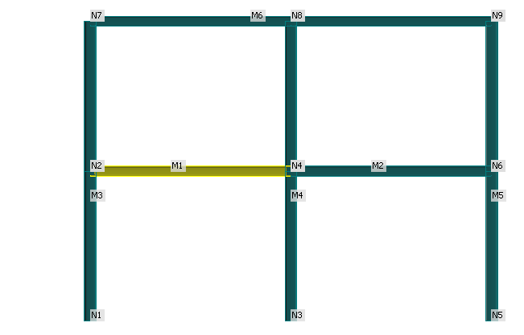

# IOM steel frame example in Python

This example builds a steel frame in IOM, the IDEA Open Model, from Python. It loads `IdeaRS.OpenModel.dll` from the
IDEA StatiCa installed on your computer with [pythonnet](https://pythonnet.github.io/). Then it creates an
IDEA StatiCa Connection project from the model, with the
[ideastatica-connection-api](https://pypi.org/project/ideastatica-connection-api/) package.

It is the Python version of the [C# steel frame example](../../csharp/SteelFrameExample/README.md), with the same
frame. The C# example goes further: it adds internal forces, a second connection, and plates, bolts and welds.

## What it shows

- Using the IOM classes from Python.
- Building a structural model in IOM: settings, a material, cross-sections, nodes, members, load cases and load
  combinations.
- A connection with the members only, for the engineer to design in IDEA StatiCa Connection.
- Saving the model, and creating a Connection project from it with the Connection API.

| File | What it does |
|---|---|
| `steel_frame.py` | Builds the model and saves it as `SteelFrame.xml`. Start reading at `create_iom`. |
| `create_connection_project.py` | Creates the Connection project from `SteelFrame.xml` and saves it as `SteelFrame.ideaCon`. |

## Requirements

- Windows with IDEA StatiCa 26.1 installed.
- Python 3.11 or newer.

## Run it

1. Install the packages, best in a [virtual environment](https://docs.python.org/3/library/venv.html):

   ```
   pip install -r requirements.txt
   ```

2. Build the model:

   ```
   python steel_frame.py
   ```

   It loads `IdeaRS.OpenModel.dll` from `C:\Program Files\IDEA StatiCa\StatiCa 26.1`. If IDEA StatiCa is elsewhere,
   give its folder as the first argument:

   ```
   python steel_frame.py "D:\IDEA StatiCa\StatiCa 26.1"
   ```

   It saves the model as `SteelFrame.xml` in the current folder and writes:

   ```
   The IOM is saved in C:\...\SteelFrame.xml
   ```

3. Create the Connection project, in the same folder, with the same optional argument:

   ```
   python create_connection_project.py
   ```

   It starts the Connection API of IDEA StatiCa and creates the project. This takes about half a minute. The Connection
   API writes its log to the console, and at the end the script writes:

   ```
   Connections in the project: M1 - M3
   The project is saved in C:\...\SteelFrame.ideaCon
   ```

4. Open `SteelFrame.ideaCon` in IDEA StatiCa Connection. Connection names the connection after its members: `M1 - M3`
   is the connection at node N2, with the members only.

## IOM in Python

pythonnet makes the .NET classes of IOM look like Python classes. Load the DLL, then import the classes from their
namespaces:

```python
import clr

clr.AddReference(str(open_model_dll))

from IdeaRS.OpenModel import OpenModel, ReferenceElement
from IdeaRS.OpenModel.Geometry3D import Point3D
```

Some mistakes pass without an error, and the model just lacks a value. A misspelt property name is one: C# reports it,
Python does not. Three short helpers in `steel_frame.py` stop the script instead.

**`create` and `set_properties`** set the properties of an object. A plain `node.x = 1` sets nothing on the
.NET object, because its property is `X`: Python keeps the value on its side. These helpers stop at a name the object
does not have:

```python
add(model, create(Point3D, Id=id, Name=name, X=x, Y=y, Z=z))
```

All values are in [SI units](https://developer.ideastatica.com/docs/iom/iom_units.html): metres, newtons, pascals.

**`add`** adds an object to the list of its type in the model, here `model.Point3D`. `model.AddObject` itself adds
nothing, without an error, when the model has an object of that type with the same `Id`. That is so in C# too.

**`find_by_name`** finds an object to refer to. An object refers to another one with a `ReferenceElement`, and a
reference to `None` saves as an empty reference:

```python
create(CombiItem, Id=id, Coeff=1, LoadCase=ReferenceElement(find_by_name(model.LoadCase, load_case)))
```

A list property that the class leaves empty, such as `ConnectionData.Beams`, needs a .NET list:

```python
from System.Collections.Generic import List

beams = List[BeamData]()
beams.Add(create_beam_data(beam))
beams.Add(create_beam_data(column))
```

The [IOM API reference](https://developer.ideastatica.com/api-iom/IdeaRS.OpenModel.OpenModel.html) describes every
class.

## The model

`create_iom` builds the model, with one function for each part. The C# example explains each part in more detail; its
sections are linked below.

- **Settings.** The design code is EN, `CountryCode.ECEN`. The material must be of the same code.
- **Material and cross-sections.** The steel is S355, a `MatSteelEc2`. Both cross-sections are rolled I sections,
  which IDEA StatiCa finds in its library by the name: HE200B for the beams and HE240B for the columns. See
  [Material and cross-sections](../../csharp/SteelFrameExample/README.md#material-and-cross-sections).
- **Nodes and members.** Nine nodes, N1 to N9, and six members, M1 to M6. A column runs through the node of the floor
  beam, so it has two segments and two elements. The columns set their local axes with a `CoordSystemByPoint`. See
  [Nodes and members](../../csharp/SteelFrameExample/README.md#nodes-and-members).

  

- **Load cases and combinations.** Two load groups, three load cases, and two linear ULS combinations. See
  [Load cases and combinations](../../csharp/SteelFrameExample/README.md#load-cases-and-combinations).
- **The connection at node N2.** The floor beam M1 ends there, and the column M3 runs through. A `ConnectionPoint`
  holds the node and the members, and a `ConnectionData` holds the members as `BeamData`. See
  [Connections](../../csharp/SteelFrameExample/README.md#connections).

## Make it your own

- **Internal forces.** `steel_frame.py` saves the model in an `OpenModelContainer`. Set its `OpenModelResult` to
  the internal forces your FEA application computed. The C# example shows what they hold, in
  [Internal forces](../../csharp/SteelFrameExample/README.md#internal-forces).
- **Plates, bolts and welds.** Add them to the `ConnectionData`, as the C# example does at node N2.
- **More connections.** Add a `ConnectionPoint` and a `ConnectionData` for each, in the same order. The Connection
  API creates only the first connection unless it gets the ids of the connection points:
  `client.project.import_iom(xml, connections_to_create=[1, 2])`, with the content of `SteelFrame.xml` as `xml`.
